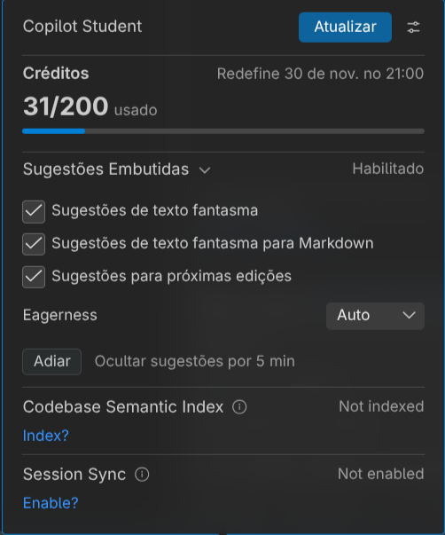
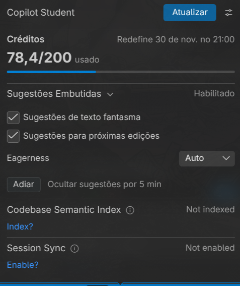

# Relatório do processo SDD

## Observação sobre consumo

Os valores abaixo são **estimativas aproximadas de tokens de contexto,
resposta e ferramentas por etapa**, calculadas a partir do volume desta
conversa e dos arquivos consultados. A sessão não disponibilizou um extrato de
créditos faturados; portanto, os números não representam cobrança oficial nem
consumo exato.

O registro inicial de créditos foi mantido na imagem original:



## Etapas realizadas

| Etapa | Atividade principal | Consumo aproximado |
|---|---|---:|
| 1 | Exploração do projeto, README, formulários, controllers, models, services e testes; criação do `docs/AGENTS.md` | 3–5 mil tokens |
| 2 | Esclarecimento de ambiguidades e criação da especificação inicial | 2–3 mil tokens |
| 3 | Criação e reorganização do plano; ajuste da ordem das tarefas e do tratamento de dados antigos | 2–3 mil tokens |
| 4 | Implementação das regras reutilizáveis de validação | 2–4 mil tokens |
| 5 | Inclusão do campo de prioridade e mensagens no formulário | 2–4 mil tokens |
| 6 | Persistência e atualização da prioridade no modelo e no board | 2–4 mil tokens |
| 7 | Integração da validação no fluxo de criação e edição | 3–5 mil tokens |
| 8 | Cobertura de regressão e aceitação | 2–4 mil tokens |
| 9 | Verificação manual no navegador, diagnóstico do favicon e correção do uso
  do Chromium do sistema | 3–6 mil tokens |
| 10 | Exibição do selo de prioridade nos cartões, atualização prévia da spec e
  do plano, testes e commit | 3–5 mil tokens |
| 11 | Transformação do processo em `skills/feature-com-spec/SKILL.md` | 2–4 mil tokens |
| **Total estimado** |  | **26–47 mil tokens** |

print  dos  creditos  após o fim  
  
  
  
## Cronologia e evidências

### 1. Análise inicial

O pedido inicial foi analisar como os formulários de criação e edição recebiam
dados e se havia validação antes da persistência, sem alterar arquivos fora do
relatório solicitado. A análise verificou que:

- o formulário usava validação nativa do HTML;
- criação e edição reutilizavam o mesmo formulário;
- o controller encaminhava os valores ao modelo;
- a persistência em `localStorage` não fazia validação de domínio;
- havia validações específicas em outras áreas, como e-mail e alarmes.

O resultado foi documentado em [`docs/AGENTS.md`](docs/AGENTS.md), com visão
geral, stack, estrutura, execução, testes e convenções.

### 2. Especificação antes do código

Foi solicitado que a especificação fosse escrita antes de qualquer
implementação. As decisões esclarecidas foram:

- a validação deveria valer para criação e edição;
- a comparação da data deveria considerar data e horário completos;
- a prioridade deveria ser um inteiro de 1 a 5;
- erros deveriam impedir o salvamento e aparecer junto ao campo.

Foi criada a especificação em
[`docs/specs/validacao-regex/spec.md`](docs/specs/validacao-regex/spec.md).

### 3. Plano e correções humanas

Foi criado o plano em
[`docs/specs/validacao-regex/plan.md`](docs/specs/validacao-regex/plan.md).
Houve uma correção importante: a tarefa de preservar a prioridade no modelo
precisava vir antes da integração da validação no controller, porque o
carregamento inicial do board ocorre antes do fluxo de formulário. O plano foi
renumerado e suas dependências foram ajustadas.

Também foi esclarecido que as tarefas antigas de demonstração seriam somente
atualizadas para a entrega, sem criar uma migração geral automática para todo o
`localStorage`.

Os artefatos foram reorganizados para:

```text
docs/
├── AGENTS.md
└── specs/
    └── validacao-regex/
        ├── spec.md
        └── plan.md
```

### 4. Implementação incremental

O trabalho seguiu uma tarefa por vez, com testes e commit antes da próxima:

1. Regras reutilizáveis de prioridade e data:
   [`services/TaskValidation.js`](services/TaskValidation.js) e testes
   correspondentes. Resultado intermediário: 46 testes aprovados.
2. Campo de prioridade, mensagens e acessibilidade no formulário:
   [`views/BoardView.js`](views/BoardView.js),
   [`components/Board.css`](components/Board.css) e testes. Resultado:
   47 testes aprovados.
3. Preservação da prioridade no modelo e no board:
   [`models/TaskModel.js`](models/TaskModel.js) e
   [`models/BoardModel.js`](models/BoardModel.js). Tarefas legadas sem
   prioridade continuaram carregáveis como `null`. Resultado: 50 testes
   aprovados.
4. Integração da validação em criação e edição:
   [`controllers/TaskController.js`](controllers/TaskController.js). Dados
   inválidos não eram persistidos e edições inválidas preservavam o estado
   anterior. Resultado: 54 testes aprovados.
5. Cobertura de regressão e aceitação nos testes de controllers e componentes.
   Resultado: 57 testes aprovados.
6. Verificação manual no navegador. Foram verificados criação válida,
   prioridades 1/3/5, prioridade inválida, data passada, edição com
   preservação de alarme/e-mail e persistência após recarregar.
7. Inclusão posterior do selo `Prioridade N` ao lado do título do cartão,
   incluindo quebra de linha em telas pequenas e omissão para tarefas sem
   prioridade. A especificação e o plano foram atualizados antes do código.
   Resultado final: 59 testes aprovados.

Commits relacionados:

```text
b511429 feat: add task form validation rules
49cb010 feat: add task priority form fields
875005b feat: preserve task priority in board model
68735da feat: validate task form submissions
82cd294 test: complete task validation acceptance coverage
2f33ec7 test: complete manual task validation
ca41144 feat: show task priority badge
```

### 5. Diagnósticos e limitações registrados

Durante a verificação manual, houve uma tentativa inicial de localizar o
Chromium em um caminho incorreto, associada ao erro de `favicon.ico`. A
orientação humana foi reiniciar o servidor, limpar o cache, diagnosticar o
problema e não alterar o código sem necessidade.

Depois foi confirmado que o navegador disponível estava em
`/usr/bin/chromium`. A verificação foi retomada usando esse navegador, sem
instalar outro navegador e sem alterar a aplicação por causa do favicon.

Os testes automatizados comprovam os casos cobertos pelos testes. A verificação
manual comprova somente os cenários realmente executados; não foi tratada como
prova de todos os cenários listados no plano.

### 6. Etapa 7: skill reutilizável

Foi criada somente a skill
[`skills/feature-com-spec/SKILL.md`](skills/feature-com-spec/SKILL.md), sem
alterar o código da aplicação, sem commit e sem push.

A skill generaliza o fluxo CDCI para qualquer stack e projeto, incluindo:

- contexto;
- spec aprovada antes do código;
- plano ordenado por dependências;
- implementação incremental;
- validação observável;
- distinção entre testes automatizados e verificação real;
- registro explícito de limitações;
- modelos preenchíveis de `spec.md` e `plan.md`.

Como revisão de aplicabilidade, foi usado um cenário hipotético de paginação em
uma API Rust com banco SQL. Isso foi apenas uma revisão textual da
generalidade da skill, não uma execução comprovada nesse cenário.

## Correções e orientações humanas incorporadas

As principais correções feitas ao longo do chat foram:

1. Não alterar arquivos durante a análise inicial.
2. Perguntar decisões ambíguas antes da spec.
3. Colocar a preservação da prioridade no modelo antes da integração no fluxo.
4. Tratar tarefas antigas de demonstração sem criar migração geral automática.
5. Reorganizar os artefatos em `docs/AGENTS.md` e
   `docs/specs/validacao-regex/`.
6. Não iniciar a próxima tarefa antes de testar e commitar a anterior.
7. Executar a suíte inteira antes de considerar a funcionalidade concluída.
8. Usar o Chromium existente em `/usr/bin/chromium`, sem instalar navegador.
9. Atualizar a spec e o plano antes de adicionar o selo de prioridade.
10. Criar somente a skill na etapa final, sem código, commit ou push.

## Estado ao final deste relatório

- Funcionalidade de validação e selo implementada.
- Suíte final: **59 testes aprovados e 0 falhas**.
- Commits da funcionalidade presentes localmente.
- Nenhum push realizado.
- A skill foi criada, mas permanece sem commit conforme solicitado.
